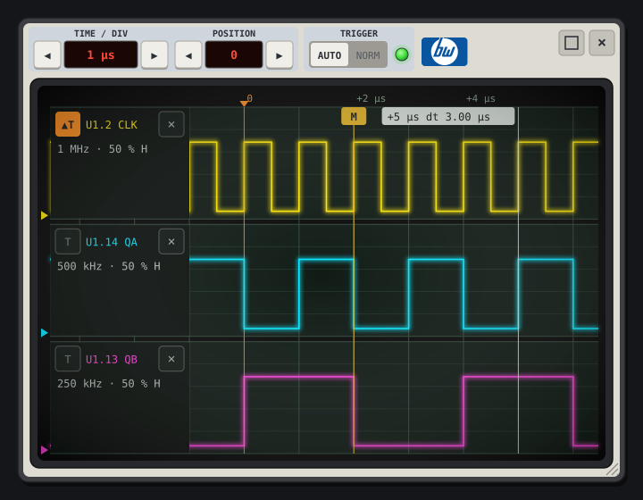
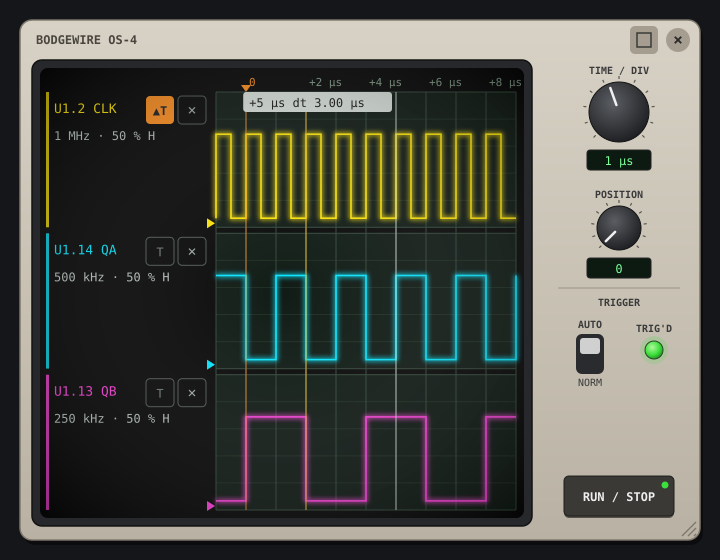
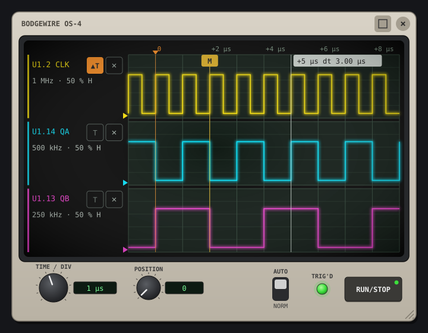
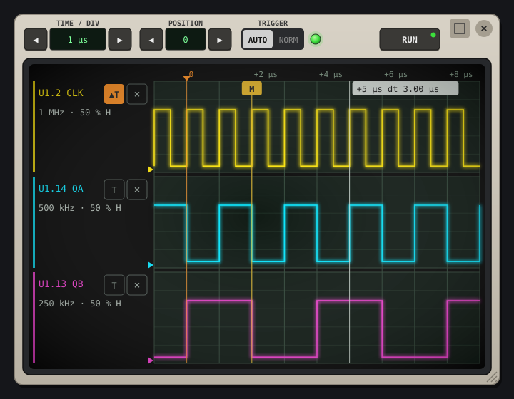
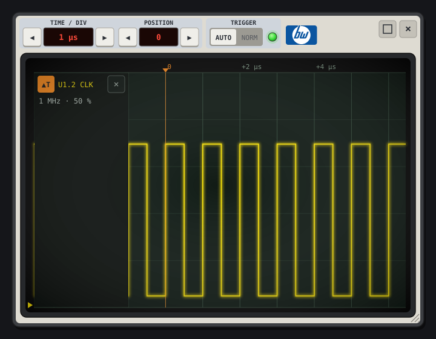
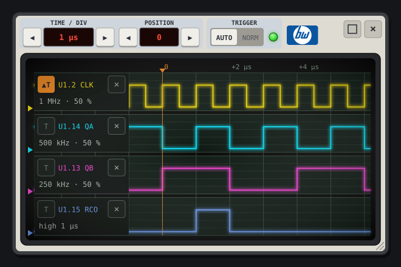
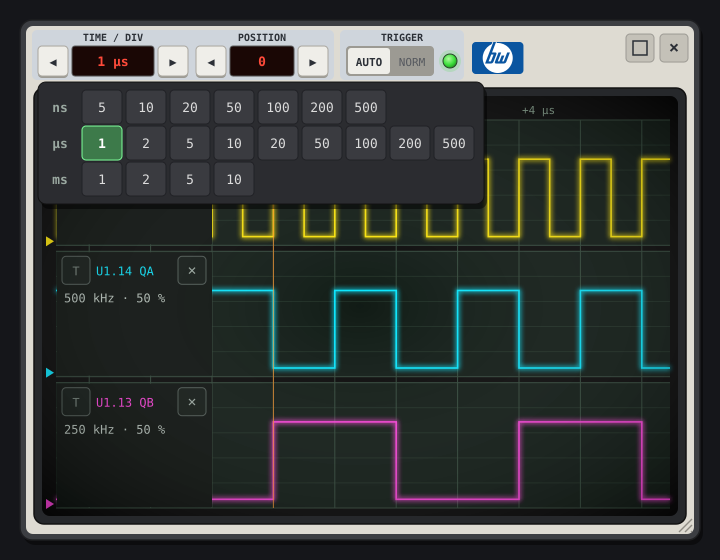

# P8h — The Oscilloscope redesigned

Roadmap step P8h (ARCHITECTURE.md#roadmap): the Oscilloscope's window rebuilt around its traces. One band per Hook, each labelled on the screen with its pin, its reading, its Trigger and its ×; the list of Hooks under the screen, the gesture hint, the status line and Run/Stop go; the case drawn like a scope, its controls a strip of push buttons along the top. The Sweeps underneath are unchanged. Design: [OSCILLOSCOPE_DESIGN.md](OSCILLOSCOPE_DESIGN.md). Plan: [OSCILLOSCOPE_PLAN.md](OSCILLOSCOPE_PLAN.md).

Mock-ups drawn by [mockups/scope_mock.py](mockups/scope_mock.py) (`python3 -I scope_mock.py` rewrites the SVGs beside it), not by the game: sizes and places are the bench's (680 × 520 normal, 620 × 400 minimal, the size it opens at since 2026-11-26), fonts and colours approximate.

## Why

The user and the agent, 2026-11-26, on the scope's window (`src/ui/scope_window.cpp`):

- The Hook list under the screen takes about 15 % of the height for nothing: the pins are already named on the screen. It is a second list of inputs, with four fixed slots, beside the screen's list of what is hooked; the two do not match (a band is reclaimed when a Hook goes, a slot is not), and that breaks the player's picture of the instrument.
- Every name is shown twice, and the label drawn on the band is crossed by the Trigger line.
- One grid for all the bands, with a single `5 V` in the top right corner: wrong (each band has its own scale) and hard to read. Nothing separates the bands.
- The cursor's `dt` and its frequency sit in the status line at the bottom left, far from the edges measured; the mouse does not land on an edge (a Finger does), so the reading is 7.97 µs where the answer is 8 µs. The user never uses the frequency.
- The gesture hint is a permanent line of tutorial text, cut off by the corner grip.
- The header is a row of generic blue buttons: the Trigger's source `1 2 3 4` says nothing of which trace it is, `T` is a label, a button and a mark on the screen, and the state (`triggered`, `auto`, `waiting for trigger`) is a word at the end of a line.
- The timebase is hard to read at a glance: 1 ns and 1 ms differ by one letter.
- With the Trigger off the screen, the axis starts with an orange `◀ T 19 µs`: orange is the Trigger's colour, so it reads as the Trigger being there, and its 19 µs is a second number for the position's 20 µs.
- It looks like the Logic Analyzer. That is fine: it is a real-time analyzer. The look is corrected by drawing it (glow, case), not by changing what it shows.

## User decisions

From a discussion (the user, 2026-11-26), with mock-ups drawn at the real sizes:

- **Bands, one per Hook, sharing the screen.** No superposition: the signals here are 0 or 5 V with no shape and often the same timing, so overlaid traces would be a tangle, and no use for them was found beyond looking like a real scope. One Hook: the full height, a simple scope. Three Hooks: three bands. A Hook removed: the others share its space.
- **One list: the labels on the screen.** The Hook rows under the screen go. Each band's label carries the pin's name, its reading and its ×; together they are the only place the player sees what is hooked. It scales with use: a player who hooks one pin sees a simple scope.
- **The labels over the screen, the Trigger one division after them.** The labels sit on a dark plate over the band's first divisions; the Trigger's default place is one division right of the plate. Against a label column beside the screen this loses nothing (about 400 px after the Trigger either way at the normal size) and gains a grid across the whole screen; at the same timebase about 6½ divisions show after the Trigger instead of 9.
- **Reordering** the bands by dragging their labels: wanted, a bonus, built in this step as its last phase (the user, asked, 2026-11-26). Moving a trace is for reordering only (no free vertical position: nothing to compare off its timing).
- **The frequency is automatic**, per band, in its label: no cursor to place for it.
- **The bands are separated**, each with its own scale: either black between them or an alternating background. If volts are printed, `5 V` at the top and `0 V` at the bottom of each band, not once for the screen.
- **The Marker stays**, its frustrations fixed: its `dt` shown on the screen at the cursor, the mouse snapping to an edge as a Finger does, the frequency taken over by the labels' readings.
- **The position stays what it is:** the time after the Trigger shown at the Trigger's place on the screen; raising it scrolls right. Useful to follow counters (Trigger on the fall of the first bit, look at all the others). No time before the Trigger beyond the division left of it.
- **The case: layout C**, the controls a strip of drawn push buttons along the top, the screen below it the whole width. No rotary knobs: the user distrusts them, being lost between 1 ns and 1 ms. (Compared: A, a panel of knobs on the right, narrows the screen to about 30 px a division; B, knobs under the screen, does not fit four bands at the minimal size.)

  | A | B | C |
  |---|---|---|
  |  |  |  |

- **The look: HP-like, made by "BW Bodge Wire"**, as far as it costs nothing in use; else the mock-up's look with the logo slapped on, and see where it lands.
- **The logo spoofs HP's 1970s–2000s mark**, or there is none (a plain navy square with `bw` is "ugly as hell"): a blue rounded rectangle, a white circle, `bw` in slanted straight strokes inside it, the b's stem leaving through the top and cutting the blue with white gaps, as the h's does; the w stays inside. Plain, chosen over a variant whose w ran on out through the bottom as a wire (as the p's descender does), which reads as "by" at 32 px.

  
- **The Hooks on the Board stay coloured discs with a number**, as today, but the number is the band's place on the scope's screen, top first; a band removed renumbers those below it ("100 % fine").
- **The timebase list as a grid by unit:** a click on the timebase's value opens three rows, `ns` (5 … 500), `µs` (1 … 500), `ms` (1 … 10); the row says the magnitude, as a knob's angle would.
- **No Run/Stop.** Pausing the bench is for the host's CPU, not a way to look at things: the scope is not designed around it. While paused the scope does what needs no code (today: the last Sweep stays on the screen, the controls as usual).
- **The case resizes freely**, as the Logic Analyzer and the binder do (the user, asked, 2026-11-26): the strip keeps its height, the screen takes the rest; the presets minimal, normal and full as now.
- **The gesture hint goes.**
- **The details live in this spec;** the ARCHITECTURE row stays one line.

Chosen without asking (proposed by the agent, not contradicted):

- Black gaps between the bands, not a lighter background: a light grey would fight the glow on a dark screen.
- The vertical time lines run through every band and across the gaps (time is what the bands share); each band has its own horizontal lines, its top 5 V, its bottom 0 V.
- No volt numbers: a coloured 0 V arrow at each band's left edge, in its Hook's colour. A level off 0 and 5 V (floating, 1.4 V) shows by sitting mid-band, its exact value in the label.
- The channel numbers leave the screen. A new Hook takes the first free Channel, so the first free colour, and its band goes at the bottom; the colour stays with the signal when reordered.
- The Trigger on the labels: a `T` on each label, lit on the source with its edge as an arrow (`▲T` rise, `▼T` fall). A click on another label's `T` moves the Trigger there; a click on the lit one flips the edge. The source unhooked: the Trigger moves to the top band; a Hook made while the source is not hooked (the first, or after the last was removed) takes the Trigger. With one Hook its `T` is lit and there is nothing to choose.
- The strip: `TIME / DIV` and `POSITION` as ◀ value ▶ with a red LED readout, a `TRIGGER` rocker `AUTO | NORM`, a `TRIG'D` lamp (lit: the Sweep on the screen was triggered; dark: auto free-running, or normal waiting) in place of the state word; the preset button and × at the right end, on the case.
- `POSITION`'s ◀ ▶ move half a screen (5 divisions), so the right half of one view is the left half of the next; a click on its value opens the number pad, as the field does now. Dragging the screen stays the fine adjustment.
- The off-screen Trigger arrow goes: `POSITION`'s readout says where the Trigger is, and the axis counts from it. The orange triangle only ever means "the Trigger is here".
- The label plate is a fixed width in px (about 150), not in divisions, and the Trigger's default place follows it: at the minimal size a plate of 2½ divisions (about 135 px) cuts `U1.15 RCO` under its ×. The plate is opaque: the Sweep engine is untouched, its Sweeps start one division before the Trigger, so nothing under the plate was captured (the mock-ups' dimmed trace there is not drawn).
- The strip's keys 44 px high (`kBig`, a finger's), 36 wide: with the badge, the preset button and the ×, the minimal size becomes 620 × 400 (from 600 × 380).
- `TIME / DIV`'s ◀ is the longer timebase, ▶ the shorter, as the Stepper's − and + now: ▶ always looks closer; both zoom about the screen's centre. `POSITION`'s ◀ is earlier, ▶ later.
- A pulse's reading names its level: `high 1 µs`, `low 4 µs` (the manuals' sync is "low for 4 µs").
- The HP-like look, none of it costing a control or a pixel of screen: a charcoal frame round a light grey panel; light grey key caps; red LED readouts (HP's 1970s counters); the strip's groups (time, Trigger) on blue-grey tinted panels; the badge at the strip's left: the logo, 32 px high, `BODGE` over `WIRE` beside it where there is room (a case at least 667 px wide: the normal and full sizes, not the minimal; moved there from the right, 2026-11-26).
- The three Service Manual setups that name channels (040 stopwatch, 050 test pattern, 060 bouncing ball) are reworded by pin: "Hook `U14.1Q` and `U14.2Q`, trigger on `U14.1Q`, rising".

## What the player sees

Draft; numbers for the design to cite.

1. **The case.** A drawn scope case, no title bar, HP-like (chosen without asking): the strip (§6) along its top, the badge at its left end, the preset button and × at its right end, the screen under it in a dark bezel, the corner grip. Dragged by its body; resized freely, the strip's height kept.
2. **The screen.** One band per Hook, top to bottom in the bands' order, sharing the screen's height, black gaps between them. Vertical time lines a division apart through all of them, counted from the Trigger; each band's own horizontal lines (5 V top, 0 V bottom, a line a volt). The axis above the bands counts from the Trigger (`0`, `+2 µs`…). The traces drawn with a glow. No Hook: the hint "Hook, then click a chip pin."
3. **A band's label**, on a dark plate over the band's left end (about 150 px, opaque): `T` (§5), the pin (`U1.2 CLK`) in the Hook's colour, ×; under them the reading (§4). Fits a band at its smallest (about 50 px: a 28 px control row and a text line). Dragged up or down, it reorders the bands. A click on the plate is the label's, not the screen's.
4. **A band's reading**, from the part of the Sweep on the screen: at least two rising edges: the frequency and the high time's share (`1 MHz · 50 %`, trailing zeros dropped as everywhere); else a whole pulse: its level and width (`high 1 µs`, `low 4 µs`); else its first edge, from the Trigger (`rises +64 µs`, `falls -2 µs`, `floats …`, `unknown …`); else, no edge, its level (`high`, `low`, `floating 1.4 V`, `unknown`); a rail: its volts (`5.0 V`). Nothing under the cursor (2026-11-26: its level's letter beside the reading read as a second, contradicting reading).
5. **The Trigger.** On the labels (chosen without asking). Its mark on the screen: the orange line and the triangle on the axis, one division right of the plates at position 0; nothing when it is off the screen.
6. **The strip.** `TIME / DIV` ◀ value ▶, the value opening the grid by unit; `POSITION` ◀ value ▶, the value opening the number pad; `TRIGGER` `AUTO | NORM` and the `TRIG'D` lamp.
7. **The position.** The time after the Trigger shown at the Trigger's place; 0 to 1000 divisions. The screen dragged, ◀ ▶ by half a screen, a value entered, a double-click on the screen back to 0; while the Trigger is hidden left of the traces, an orange `◀ Trigger` key in the corner above the labels, back to 0 too (2026-11-26: the Trigger is easily lost zooming with the wheel). The wheel and a pinch zoom about the pointer, as now.
8. **The Marker and the cursor.** A click on the screen places the Marker (its flag at the top, as now; a click on the flag or a right-click clears it). The cursor carries a tag at its top: its time, and with a Marker, `dt` from it; the tag flips to the cursor's left near the right edge. The mouse's Marker and cursor snap to an edge of the band they are on within 12 px, as a Finger's do.
9. **The Hooks on the Board**: each a disc in its Hook's colour by its pad, as today, numbered by its band's place on the screen (1 the top band); reordering or removing a band renumbers them.
10. **Gone:** the Hook rows, the status line and its gesture hint, the `1 V/div` text, the `1 2 3 4` source buttons, the state word, Run/Stop, the off-screen Trigger arrow, the title bar.

| One Hook | Four Hooks, minimal size | The timebase grid |
|---|---|---|
|  |  |  |

## What is new

1. **The view behind the plate** (`src/view/time_view`): the scope's view and settings with the plate's width as a lead of divisions before the Trigger's division; the cursor's tag text; the timebase grid's rows.
2. **The readings** (`src/view/scope_reading`, new): a band's reading from a Sweep's Samples, pure.
3. **The bands' order** (`src/session/scope_setup`): the hooked Channels top to bottom, kept across rebuilds, moved by a drag; the Trigger's source follows an unhook. The Board's Hook discs numbered by it (`src/ui/board_tags`, `board_view`).
4. **The screen** (`src/ui/scope_window`): bands, gaps, plates and labels, the Trigger on the labels, the cursor's tag, the mouse's snap; the Hook rows, the status line and its hint gone.
5. **The case and the strip** (`src/ui/scope_case`, `src/ui/bw_logo`, new; `src/ui/instrument_marks`): the drawn case with no title bar, its keys, LED readouts, rocker, lamp and badge, the timebase grid, the size preset and the × on the case; Run/Stop gone.
6. **Docs**: the three manual setups by pin, GLOSSARY, the instrument recipe, README's scope picture.

Untouched: the Sweep engine (`src/instruments/oscilloscope`), the consumer, the kernel, the Logic Analyzer, the Machines but three manual lines.

## Tests

- Unit: `time view:` cases for the lead, the cursor's tag and the timebase rows; `scope reading:` cases (a clock, a lone high pulse, a lone low pulse, a constant, floating, X, a rail, a Sweep with no Samples); `scope layout:` cases (the strip fits at 620 px, the words at 720, the bands); `session:` cases for the bands' order (hook, unhook from the middle, move, the source following its Hook, across a rebuild).
- Screenshots (release, viewed): one Hook; three with the Marker and the cursor's tag; four at the minimal size; a Hook removed from the middle (bands and Board numbers); the timebase grid open (`--tap`); a finger's hold; the 050 README shot; popped out; the web build.
- Speed: the BW-80 with four Hooks: 1.00×, UI under 1 ms.
- Sanitizers: the debug cases of the new view files and the scope's `session:` cases (never the BW-80's or BW-2001's).
- Only the user can check: the mouse's snap (every scripted pointer is a finger), the keys' and the drag's feel.
- The full release suite before the last commit.

## Later

- Single: hold the next triggered Sweep (for a signal that differs at every Sweep). In normal mode a rare Trigger already holds its Sweep until the next.
- The Trigger centred or moved on the screen.
