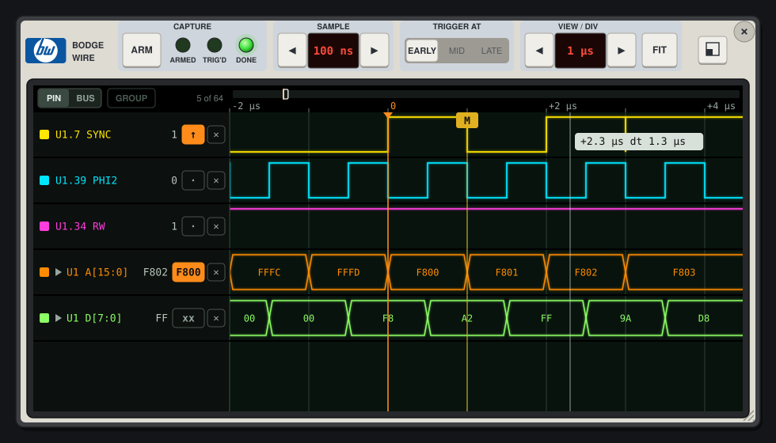
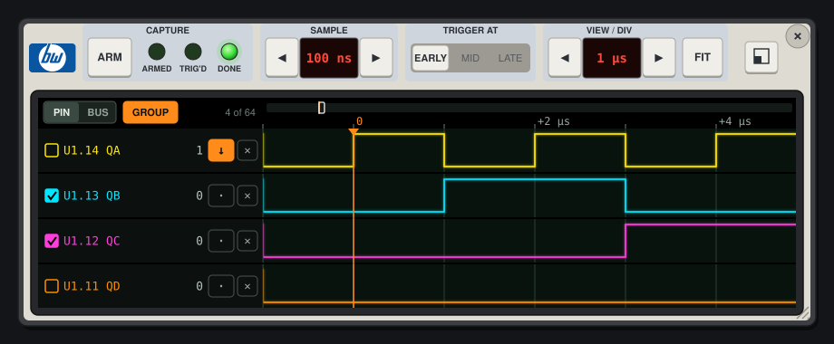
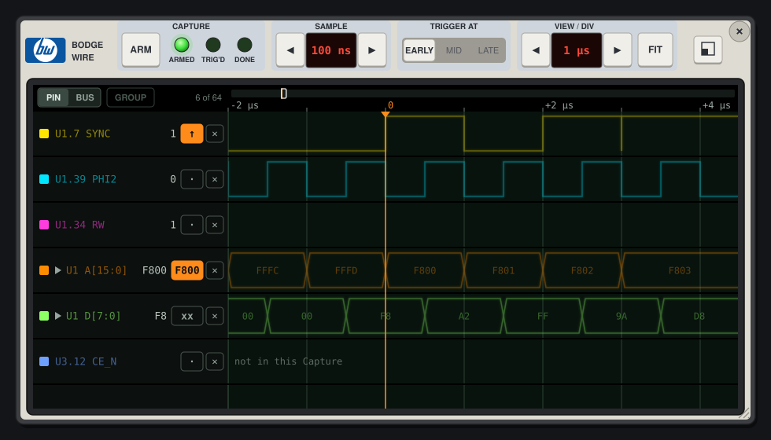

# P8i — The Logic Analyzer redesigned

Roadmap step P8i (ARCHITECTURE.md#roadmap): the Logic Analyzer's window given the Oscilloscope's treatment (P8h) where its many uses allow: a drawn case by Bodge Wire, a strip of keys, its rows labelled on the screen, the cursor's tag at the cursor, no status line; and two bugs fixed where it shows a Capture that is not what happened. The Capture engine (`AnalyzerState`, `AnalyzerConsumer`) stays; `AnalyzerSetup` gains the rows' order and arms on a new Clip and at power-on. Design: [LOGIC_ANALYZER_DESIGN.md](LOGIC_ANALYZER_DESIGN.md). Plan: [LOGIC_ANALYZER_PLAN.md](LOGIC_ANALYZER_PLAN.md).

| Minimal size, two plates ticked: GROUP lit | Armed after a new Clip: the old Capture dimmed, the new pin's lane empty |
|---|---|
|  |  |

The mock-ups predate two decisions of 2026-11-27 (below: no TRIGGER AT, the lamps folded into `ARM`; the minimal size 620 × 340). Mock-ups drawn by [mockups/analyzer_mock.py](mockups/analyzer_mock.py) (`python3 -I analyzer_mock.py` rewrites the SVGs beside it and prints the strip's widths), not by the game, at its sizes (keys 36 × 44, the scope's case): 940 × 520 normal, 880 × 340 minimal.

Drawing them changed three things (the agent; taken by the user, 2026-11-26, "we may have to revisit later"):

- **`PIN | BUS` and `GROUP` sit in the screen's corner above the plates**, not in the strip. With them the strip does not fit 940 px; and both act on the rows, under which they now sit, with the count of Clips (`5 of 64`).
- **The minimal size grows to 880 × 340** (from 820): the strip's groups need about 870 px with the logo alone. Keeping 820 would mean dropping `FIT` from the strip (a double-click on the screen fits too).
- **The plate is 248 px**, not 200: a bus's name, its value and its pattern key (`U1 A[15:0]  F802  F800`) need it.

And one the user asked for: **the screen is drawn to its bottom** under the last row (its background, the grid's lines, the plates' column, the Trigger, Marker and cursor lines), so the part no row uses still reads as the screen, not as an empty window.

## Why

The agent, 2026-11-26, on the analyzer's window (`src/ui/analyzer_window.cpp`), from screenshots of the LED computer (SYNC, PHI2, RW, the address and data buses) and of the counter:

- **It is the last generic window on the bench**: a title bar, flat blue ImGui buttons, grey labels, next to the drawn TV, keyboards and scope.
- **Its header is two lines mixing three concerns**: the Capture (Arm, the phase as a word, the sample period, "Before T"), the Clips (`27 of 64 clipped`, `pin | bus`, a `Group` button that appears with two selected) and the view (`− 1 µs/div +`, `Fit`, `T`, `6.55 ms captured`).
- **"Before T" offers three times that change with the sample period** (655 µs, 3.28 ms, 5.9 ms at 100 ns) for what is "the Trigger early, in the middle or late in memory".
- **The label column takes 360 px**, 38 % of the 940 px normal width: a 76 px Trigger button on every row, nearly always `any`, and a value column empty but under the cursor. The Trigger as a whole (SYNC rising and the address bus at `F800`) is never shown at a glance.
- **The cursor's time, the Marker's and `dt` are in a status line** at the bottom left, far from the edges, and a gesture hint the rest of the time; the mouse does not snap to an edge.
- **The overview's box is a sliver** at any useful zoom (1 µs/div over 6.55 ms: 0.15 % of its width). The user never used it.
- **Rows are a fixed 28 px**: four Clips fill a third of the window.
- **Grouping is hidden** (a click on a name selects it, `Group` appears in the header; ungrouping is behind ×). **Colours collide** (the address bus and RW both magenta). **The Board's discs show the Channel number**, not the row.
- **Arm is one-shot**: after a Capture, seeing the circuit again means pressing Arm.
- **It shows Captures that are not what happened** (the user, 2026-11-26; reproduced by the agent): two Clips, pause, the second unclipped, another pin clipped: the new pin takes the freed Channel and its row, `U5.15 RCO`, draws the old Capture's Channel, U1.13 QB's waveform, under a faint `U1.13 QB`. And Arm pressed while paused reads `armed: waiting for trigger` above the previous Capture in full colour, which nothing will replace until the run resumes.

What works and stays: the Capture model (64 Channels, 65 536 points, the sample period, the Trigger early, middle or late), the bus rows in hex in slanted cells, a bus clipped from one pin's stem, the Trigger conditions per Channel and the bus pattern with `x`, zoom about the pointer, the Marker and `dt`.

## User decisions

The user, 2026-11-26, on the agent's list of ideas:

- **A drawn case in the scope's family**: the same frame, panel, key caps, red LEDs and BW logo; no title bar; the size key and × on the case; dragged by its body.
- **A strip of keys, one group per concern**, left to right: the badge; CAPTURE (`ARM`); SAMPLE (◀ LED ▶, the LED opening the grid by unit); VIEW (◀ LED ▶ for the zoom, `FIT`); the size key. Hard to judge before seeing it; taken as proposed (`PIN | BUS` and `GROUP` then moved to the screen's corner, above).
- **Labels on the screen**: each row's one-line plate over its lane's left end (swatch, name, value, Trigger key, ×); no column headings.
- **The Trigger as a lit key on each plate**, dark on `any`, lit orange with its condition otherwise (`0`, `1`, ↑, ↓), a group's with its pattern (`F800`). The whole Trigger summed up in the strip only if it fits: it does not (the strip fills 940 px), so not.
- **The cursor's tag on the screen** (its time, `dt` from the Marker), the mouse snapping to an edge; the status line and the gesture hint go ("status lines are evil").
- **The value at the Trigger** on each plate when there is no cursor or Marker.
- **The overview kept, thin**, inside the screen above the time axis. Unused so far, maybe for the window's other troubles.
- **Rows grow to fill the screen when few** (28 px up to about 56), and scroll when many.
- **Rows reordered by dragging their plates**; the Board's discs numbered by row place, as the scope's Hooks are.
- **Colours by row**, a group's members in their group's colour.
- **Grouping visible**: the plates' swatches tick; two Channels ticked light the `GROUP` key; a group ticked turns it into `UNGROUP` (asked, 2026-11-26: a key of its own on a group's plate does not fit beside its pattern and ×).
- **No TRIGGER AT; the phase on the ARM key** (2026-11-27, the window being too wide): the Trigger stays early in memory (10 %), enough for every manual's setup (the most history read before a Trigger is 2 ms, at 10 µs a sample: EARLY keeps 65 ms there); `ARM` lit amber while waiting for the Trigger, green while filling, dark with a Capture shown, in place of three lamps. The minimal size 620 × 340, the scope's width; BODGE / WIRE from about 650 px.
- **It opens at its minimal size**, as the scope (2026-11-27); **an orange ◀ or ▶ at the axis's end** while the Trigger is off the view brings it back (the scope's ◀, 2026-11-26).
- **One-shot Captures, re-armed at every power-on**: repair, power on, read the new Capture, no key; `ARM` captures again without a power cycle. A repeating Run rejected: stable only on a repeating signal, which the scope already shows, and studying a CPU's Capture would need Stop back.
- **`ARM` resumes a paused run**: pause saves the host's CPU, it is not a way to capture. Powered off, `ARM` waits for the power-on, which arms anyway.
- **A new Clip always arms** (today only while the analyzer waits: after a Capture the phase stays `captured`), since its lane is empty until a Capture that has it. While paused it arms without resuming, so several pins can be clipped first.
- **The analyzer never shows a Capture that is not what happened** (the two cases above): fixed in this step. Other surprises the user met are forgotten but the pause; to be found with the new design.

Chosen without asking: what goes with the old header: the `T` key (centre on the Trigger: `FIT` and the overview do it), the off-screen Trigger's `◀ T 19 µs`, `6.55 ms captured` (the overview shows the Capture), Stop (`ARM` restarts a waiting Capture); every key at least 28 px for a finger, drawn smaller where it sits on a plate; the overview's height (about 10 px), the grown rows' height (up to 56 px: five rows leave the screen's bottom fifth to its grid at the normal size), the lamps' and keys' names, the empty Trigger key's `·` (a bus's: `xxxx`).

## What the player sees

1. **The case.** A drawn case, no title bar, the scope's frame and panel: the strip along its top, the screen below in a dark bezel, the size key and × at the strip's right end, the corner grip. Dragged by its body; resized freely; the presets minimal, normal, full as now.
2. **The strip** (decided above), drawn as the scope's: key caps, red LED windows. `ARM` lit amber while waiting for the Trigger, green while filling after it, dark with a Capture shown. SAMPLE's LED `100 ns`, its grid by unit as the scope's timebase. VIEW / DIV's LED `1 µs` (the label says per division, as TIME / DIV's on the scope).
3. **The screen.** Its top left corner, above the plates: `PIN | BUS`, `GROUP`, the count of Clips (`5 of 64`). Above the lanes: the overview (thin, the view as a box, the Trigger and Marker as ticks), the time axis. Then the rows, each a lane with its plate, black between them; under the last row the screen goes on to its bottom, its grid and marks too.
4. **A plate**: a swatch (a tick box for grouping), the name (`U1.7 SYNC`, `U1 A[15:0]` with its fold arrow), the value (at the cursor, else the Marker, else the Trigger: `1`, `F802`, `X`), the Trigger key, ×. Dragged up or down, it moves its row.
5. **The cursor's tag** at the cursor on the screen: `+2.3 µs   dt 1.3 µs`. The mouse and a Finger land on an edge of the row they are on within 12 px.
6. **The Board's discs**: each Clip's disc in its row's colour, numbered by its row's place (a group's members by the group's).
7. **Arming.** A power-on arms; a new Clip arms; `ARM` arms, and resumes a paused run. Each new Capture replaces the shown one.
8. **What a row shows** is only what its own pin recorded: a row whose pin was not clipped on that Channel for the shown Capture has an empty lane (`not in this Capture`), never another pin's waveform. While armed, the shown Capture is drawn dimmed until the new one comes.

## What is new

To settle in the design, file by file:

1. **The case and the strip**: from the scope's `scope_case` and `bw_logo`, shared where the two cases are drawn alike.
2. **The screen**: plates, Trigger keys, the cursor's tag, rows that grow, the thin overview, in a pure layout tested in `src/view` as the scope's.
3. **The rows' order** in `AnalyzerSetup`, the Board's discs numbered by it; colours by row.
4. **Arming**: by every new Clip and at every power-on (`AnalyzerSetup`, its arming handed to the consumer as `ARM`'s is); `ARM` resuming a paused run; a row's lane drawn only from its own pin's Samples (the Capture's labels per Channel).

The sampling and the Trigger, the runner, the scope and the Machines are untouched.

## Tests

To settle in the design: unit cases for the layout, the rows' order, the re-arming at power-on and by a new Clip; a case for a Channel reused after a Capture, not in it; screenshots of the LED computer and the counter at the three sizes; the full release suite.

## Later

- **Decoding a bus**: a data bus row read as ASCII, or as 6502 / Z80 instructions at SYNC or M1 (the binder's Contents disassembles both). Not trivial: the data bus carries other traffic (the BW-80's video), and instruction bytes need not be contiguous.
- **Search**: go to the next or previous point where a row has a value (`F800`) or an edge. Much missed.

Rejected: saving a Capture to compare with the next (too complex for its use).
