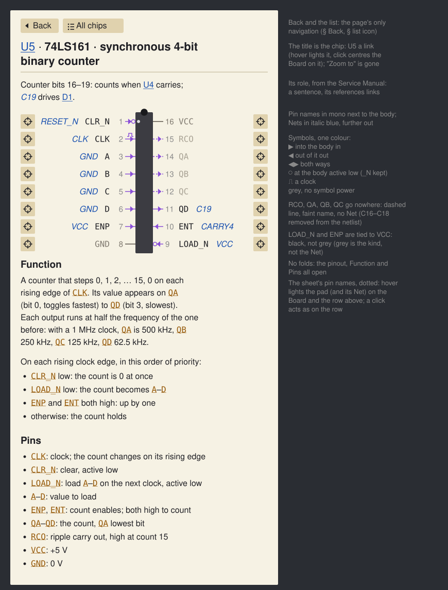
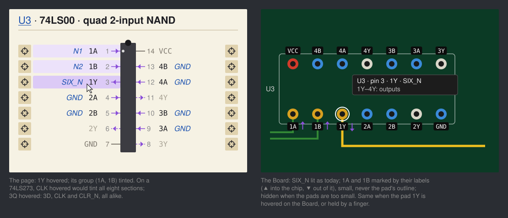

# P8j — Datasheet polish

Roadmap step P8j (ARCHITECTURE.md#roadmap): the binder's Datasheets divider made easier for a novice without making it harder for an expert. One view of a chip (the generic sheet goes), a title that is the chip, the Machine's role sentence with live links, a pinout that shows each pin's direction and which pins work together (on the page and on the Board), the sheet's text lighting the pins it names, a way back, and each chip page keeping its place. Design: [DATASHEET_POLISH_DESIGN.md](DATASHEET_POLISH_DESIGN.md). Plan: [DATASHEET_POLISH_PLAN.md](DATASHEET_POLISH_PLAN.md).

Mock-ups (drawn by [mockups/datasheet_mock.py](mockups/datasheet_mock.py), `python3 -I datasheet_mock.py`, at the game's sizes; grey notes are the mock-up's):

## Why

The user, 2026-11-27, reading U5's page on the Counter (and the agent's screenshots of the Dice), from top to bottom:

- **Two views of a sheet.** A chip selected or hovered on the Board shows its chip view (pinout with this Board's Nets, Function, Pins); a Part name clicked in the list shows a generic sheet (Function, Pins) with no pinout and nothing tied to the Board. The generic one adds nothing.
- **"All datasheets" is a button like "Zoom to"** but does something else entirely: it leaves the page, "Zoom to" only moves the Board.
- **No way back.** A link followed from a page loses it; nothing returns, as a browser's Back would.
- **The scroll is kept per tab, not per page**: scrolled down U4's page, U5's opens at the same depth (a bug). The Contents divider (P6p) has the same.
- **The header does not read as a title.** `U5 · 74LS161 · synchronous 4-bit binary counter` is the page's subject but drawn as a line of text; `U5` is not a link and does not look like one. The tooltip on a pin row writes the same kind of facts with other separators (`2  1B  N2`, ` - `).
- **The role sentence is the page's key line but reads as a fragment**: `counter bits 16–19: counts when U4 carries; C19 drives D1` (from the Service Manual's Components list) starts in lower case, and `U4`, `C19`, `D1` are plain text where the Service Manual links them.
- **The pinout says nothing at a glance**: which pins are inputs, outputs, both, active low; only power is greyed. It has to be worked out from the text.
- **Pin names and Net names look alike**, and sometimes are the same text: `CLK  CLK`, `VCC  VCC`, `GND  GND`.
- **A pin that goes nowhere shows two ways**: `RCO  -` but `QA  C16`, though on the Board both are a pad with no copper. `C16`–`C18` are one-pin Nets the player never needs; the player's manuals never name them.
- **Which pins work together is hidden**: on a 74LS08, `3Y` is the output of `3A` and `3B`, found by reading names and counting pins ("ok, this is 3Y… so it takes what? ah, pin 9 and pin 10. Where are they?"), every time a trace is followed.
- **Function is open, Pins folded**; folding only hides information. A finger, which has no hover, reaches a pin's line only through the folded Pins.
- **Some sheets carry what the player does not need**: netlist syntax (`contents=`, `offset=`, `.bin`, `value=47p`, `select=`) and pin names meant generically (`D`, `Q` for "each flip-flop's").

What works and stays: the Datasheets list grouped by Part type, its references hovered to light the chip (the expert's index on the large Machines: "where are the 2114s?"); the chip view following the hovered, else the selected chip (`BoardView::pointedComponent`: "it is what it is"); a selection turning the binder to Datasheets; a pin row's hover lighting its Net, its click working the instrument in hand (P8g); no tool ever acting from a link; links that light on hover and frame and select on a click.

## User decisions

The user, 2026-11-27, with the agent sparring for the expert (the user's goal: "make the work of novice users easier"; the agent's role: "prevent a simplification that would make the non-novice's life harder in corner cases"):

- **The generic sheet goes.** A chip's page is always the chip view. The list stays; its Part names are no longer links, its references open the chip's page.
- **"All datasheets" becomes a list icon**, not a word button; the same icon on the Datasheets pages. Possibly on the Datasheets tab itself (open, below).
- **Never navigate by hover.** A hover lights; only a deliberate act (a click on a link, on the Board, in the list) changes a page, enters a history or changes what is kept.
- **Back, as a browser's.** Orthogonal to keeping a chip at hand (below).
- **Forward too, both as arrows** (the user, 2026-11-27, after using Back: "awkward to have a back but not forward… maybe just an arrow would be enough"): ◀ ▶ without words, as a browser's, each dimmed with nowhere to go (Forward stays in place, dimmed until a Back, so All chips never moves); a tooltip names each. Then (the user: "there are no arrows on non datasheet pages, so as soon as we go back there, we're lost"): the arrows sit above every page of the binder, fixed, never scrolled away.
- **Back returns exactly where you were**, not to the top: **the scroll is kept per chip, not per tab.** A chip never visited opens at the top. Per chip, not per Part type (U4 and U5 are both 74LS161 and their role lines differ).
- **The reading size (aA) is not a concern**: "people choose one size and never change". If a natural way of keeping the place survives a reflow, good; nothing more is done for it.
- **Chip-level pages and Machine-level pages.** Datasheets and Contents show a chip, chosen per chip: their place, history and (Contents) view kept per chip. The User and Service Manuals, Repairs and Give up are one page each, as now.
- **The title is the chip**: `U5 · 74LS161 · synchronous 4-bit binary counter`, a title with a separator. `U5` in it is a reference link: hover lights the chip, a click centres the Board on it. **"Zoom to" goes** (the title does it). What "centring" means exactly is for later.
- **Hover highlights without moving; a click centres.** The rule for references everywhere in the binder (it is already how links work: `RouteLink`, `src/view/focus.cpp`).
- **Clear looks for the kinds of name**: chip references (`U5`), Part types (`74LS161`), pin names (`CLK`), Net names (`C19`). One separator everywhere (the title's ` · `). Pin and Net need different looks but not an accessible one (not colour-blind safe): the pin name is always there next to the body, the Net optional and further out.
- **The role sentence is a sentence and its references are links** (from the Service Manual, as now): capital first letter, `U4`, `C19`, `D1` light the Board on hover and act on a click as in the Service Manual.
- **The pinout shows each pin's kind**: in, out, in-out (both ways), active low (a bubble; the `_N` name unchanged, since the Board, the manuals and `U5.LOAD_N` all write it so), power greyed as now (by the pin's kind, not its Net: `LOAD_N` tied to VCC stays black). Small symbols in one colour, the same for every kind of pin, a colour not already meaning something on the Board (levels, the hovered Net, the clips' numbers).
- **No edge marks for their own sake**: the edge-clocked inputs already say so in their Pins line ("the count changes on its rising edge"). A small *pulse* symbol marks a clock among the section marks (below).
- **No permanent marks on the Board**: parked "unless we have a brilliant idea".
- **One-pin Nets**: a pin whose Net reaches no other pin looks the same whether it has a Net name or not ("don't overload the user with irrelevant info"). The netlists' names are kept only where a player's manual uses them (open, below).
- **The sheet's text lights the chip's pins**: a code span that is exactly one of this Part's pin names, or a range of them (`` `1D`–`8D` ``), lights its pads (and so its Net) on hover; anything else (another chip's pin, an address) stays plain. A Net lit is the next best thing for another chip's pin: hovering `WRITE` in CASSETTE's text lights the trace to the VIA's `PB3`.
- **Generic pin names become ranges** in the sheets (`D` → `` `1D`–`8D` ``), so they light.
- **Sections: hovering a pin marks the pins it works with**, on the page and on the Board: on a Part with sections (a digit before the name: `3A`, `3B`, `3Y`; 22 of the 72 Parts), a section's pin marks its section and the shared pins (those without a digit: `CLK`, `CLR_N`, `S`, `G_N`); a shared pin marks every section ("it tells you nothing only if you knew that CLK drove all the pins"); a Part without sections marks nothing. Shared and section pins look the same ("the clock is as important as the data in"). The marks are the pinout's symbols, the clock (`…CLK`) with the pulse.
  - On the page: hovering a row (or a pin's name in the text) highlights its group's rows.
  - On the Board while hovering in the page.
  - On the Board while hovering a pad: "you don't have to open the datasheet to follow a trace".
- **The function is not drawn**: hovering the chip says it.
- **No folds**: the pinout, Function and Pins all open ("what is the purpose of folding, apart from missing important information?"). A finger reads a pin's line on the page.
- **The double tooltip** seen once after a scripted tap: not cared about ("fixes itself at the next tap or move").

Chosen without asking (the agent, to overturn freely):

- **The page shows the Board as designed, never the fault**: Nets, "goes nowhere", sections come from the design (`BoardScene` already: "nothing here depends on Faults"). A wire the player adds, a cut trace, change nothing on the page; the instruments show them.
- **A section's marks on the Board are secondary to the hovered pad**: small, on the pad's edge or its label, never the pad's outline, so a tool's target stays unmistakable; hidden when the pads are too small to read them (as the pin labels).
- **Netlist syntax leaves the player's sheets** (`contents=`, `value=47p`…) for the Parts' development docs or ADD_PART.md.
- **Without a Board** (a bare netlist opened in development; every Machine has one), the list's Part names are plain text: no sheet.
- **Net names in the link blue, upright**, not italic as the mock-ups draw them: the game's faces are Atkinson Hyperlegible regular, bold and mono, with no italic. A Net that is a link (the role sentence's `C19`) is underlined as every link; the pinout's Nets are not links (their row is).
- **No folds on the chip pages only**: the User and Service Manuals keep their collapsible headings (a later row may follow).
- **A range of pins in the text lights their pads, not their Nets** (the Board lights one Net at a time); one pin lights its pad and Net. A click on a range shows the chip, as a reference does.
- **A sheet's text links only this chip's pins**, never a reference: today a sheet links any code span that is a part's reference, so on the LED computer the 6502 sheet's `D7` (a data pin) is a link to the LED `D7`. Fixed by the rule.
- **A clock is a pin named `CLK`, `CLK` and a digit (the 74177's `CLK1`, `CLK2`), ending in `CLK` (`1CLK`), `CKA`/`CKB` (74LS90/93), or `PHI` with or without a digit (`PHI0`–`PHI2`: the 6502, 6520, 6522, 6530, 2524; the expansion connector's `PHI`)**, on every Part: the pulse symbol over its arrow (the 6502's `PHI0` a clock in, `PHI1`/`PHI2` clocks out). The user, 2026-11-27: "PHI2 should probably get a pulse". Not `CA1`/`CB1` (edge-sensitive control lines), not the 373's `LE` (a level), not the oscillator's `OUT` (a clock by its function, not its name: its page says so).
- **Open collector**: the output's arrow drawn hollow; `NC` pins: no line, the number alone, faint.
- **One separator, ` · `**: the title, a pin's tooltip on the page (`pin 3 · 1Y · SIX_N`, then its line) and the Board's pad tooltip (`U3 · pin 3 · 1Y · SIX_N`).
- **Removing one-pin Nets changes Random faults' draws** on the Counter, the LED Chaser, Tennis and the BW-2001 (a draw picks among the pads on Nets): a seed gives another fault than before. The tests check properties, not given faults.

## What the player sees

### The Datasheets list

1. **The list of the Machine's Parts**, as now: one line a Part type, its references after it; a reference hovered lights its chip, clicked selects it and centres the Board on it (the chip's page follows). **A Part's name is plain text**: no generic sheet.
2. **Back and Forward** (◀ ▶) above every page of the binder (the list, a chip, the manuals, Repairs, Contents, Give up), fixed while the page scrolls, each dimmed with nowhere to go.

### A chip's page

3. **Keys at the top**: **◀ ▶** and, on a chip's page only, **☰ All chips** (the list: the Board's selection cleared, as "All datasheets" did; a hover on a chip still shows its page).
4. **The title is the chip**: `U5 · 74LS161 · synchronous 4-bit binary counter`, bold, a rule under it. `U5` is a link (hover lights the chip; a click centres the Board on it and selects it). **"Zoom to" is gone.**
5. **The role sentence** from the Service Manual's Components bullet, its first letter a capital, its references, pins by name and Nets links as in the Service Manual: `Counter bits 16–19: counts when U4 carries; C19 drives D1`.
6. **The pinout** (a DIP's body with its pins either side, as now) with, on each pin's line between its number and the body, a **symbol in one colour (violet)**:
   - an input: an arrow into the body; an output: out of it; open collector: out, hollow; both ways: both;
   - active low (`_N`): a bubble at the body, the name unchanged;
   - a clock (`CLK`, `CLK1`, `1CLK`, `CKA`, `PHI2`…): a small pulse over the line;
   - power: a plain grey line, the row grey as now (by the pin's kind: `LOAD_N` tied to VCC stays black); `NC`: no line, the number faint;
   - a pin of anything but a chip (a resistor, capacitor, LED, digit, switch, connector: their `PartKind`): a plain line; a chip's `PullUp` pin (the 6520's ports, the MC3446's bus) works both ways.
7. **A pin that goes nowhere** (its Net reaches no other pin): a dashed line, its name faint, its Net's name shown only when it has one (only the nine the manuals name, §15).
8. **Pin and Net look apart**: the pin name in the mono face next to the body, the Net in the link blue further out.
9. **A pin's group**: hovering a pin's row, or its name in the text, tints the rows it works with (§13), the hovered row darker.
10. **Function, then Pins, both open, no folds.** In both, a code span that is exactly one of this Part's pin names, or a range of them (`` `1D`–`8D` ``), is a pin link: dotted underline; hover lights the pad on the Board (one pin: its Net too) and the group's rows (§9); a click acts as a click on the pin's row (the instrument in hand works it; a range shows the chip). Other code spans stay plain.
11. **The tooltip on a pin's row**: `pin 3 · 1Y · SIX_N`, then its Pins line.

### Back and places

12. **Back** returns to the page before, exactly where it was: a chip's page or the list, or a Machine page (a Service Manual step → U5 → Back returns to that step). Going back to a chip selects it without moving the Board. **Forward** undoes a Back, as a browser's; any other move clears it. A mouse's back and forward buttons (X1, X2) do the same over the binder, on the desktop (in a browser they are the browser's). **Each chip's page and each chip's Contents keep their own scroll**: a chip never seen opens at the top. A hover never enters the history; a tab clicked, a link or the list followed, a chip selected on the Board do.

### Sections and the Board

13. **What a pin works with**: on a Part with sections (a pin name starting with a digit: `3A`, `1CLK`; 22 of the 72 Parts), a section's pin works with its section's other pins and the shared pins (no digit: `CLK`, `CLR_N`, `S`, `G_N`); a shared pin works with every section's pins. Power and `NC` pins never. A Part without sections: nothing.
14. **On the Board**, while a pin is hovered (its row or its name on the page, or its pad on the Board), or held by a finger: the pins it works with, and itself, get a small violet mark beside their name plates: an arrow towards the chip (in) or away (out), both ways, a pulse (clock). Shown only when the pin names are (their pad big enough, `kPinNameMinPadPx`). Never the pad's outline: the hovered pad and its Net light as now. The pad's tooltip reads `U3 · pin 3 · 1Y · SIX_N`, a chip's `U5 · 74LS161 · synchronous 4-bit binary counter`.

### Behind the page

15. **One-pin Nets**: the Nets no player's manual names are gone from the netlists (Counter `C0`–`C18`; LED Chaser `C0`–`C14`; Tennis `LP1`, `RP1`, `ST1`, `ST2`; BW-2001 `CHASSIS`, `SEL3_N`–`SEL6_N`, `SEL10_N`), their pads' Net names gone from the KiCad Boards; the nine the manuals name stay. Loading a Machine's manuals warns of a Net reaching one pin that neither manual names.
16. **The sheets**: pin names meant generically (`D`, `Q`, `A`, `B`, `Y`) rewritten as ranges; the netlist's syntax (`contents=`, `offset=`, `select=`, `value=`, `.rom`, `.bin`) out of the player's sheets, into ADD_PART.md and the netlist's docs where it is not already.

## What is new

1. **Pin looks and groups** (pure, `src/view/`): a pin's symbol from its kind and name; a pin's group from its Part's pin names.
2. **The binder's places and history** (`view/binder`): Back, the chip page's place, the list.
3. **Links in a chip's sheet** (`manual/`): a scope for one chip's pins, ranges included; references no longer linked in sheets; the role sentence as spans.
4. **The chip page** (`ui/chip_panel`, `ui/manual_window`): title, role, keys, no folds, per-chip scroll, the pinout's symbols, looks and group tint.
5. **Board marks** (`ui/board_view`): a hovered pin's group beside the name plates; the pad tooltip's separators.
6. **Netlists and Boards**: one-pin Nets removed (four Machines); the manuals' check.
7. **Sheets**: ranges, netlist syntax moved.

Untouched: the kernel, the Parts, the instruments, Puzzles, the Launcher, the other dividers but Contents' scroll.

## Tests

- Unit: pin looks and groups (`pin marks: …`, every sectioned Part's groups checked against its pin names: 74LS00, 74LS273, 74LS157, 74LS74, 74LS244), the binder's history (`binder: …`), the chip scope's links (`manual: chip pins …`: one pin, a range, another chip's pin plain, `D7` on the LED computer plain), the role's spans, the one-pin Net warning.
- Machines: `manuals_test` passes on every Machine with the new warning; `check-board` and the `drc_*` cases on the four Boards changed; the Counter's, Chaser's, Tennis's and BW-2001's cases.
- Screenshots (release, viewed): U5 on the Counter (the mock-up's page), U3 on the Dice with `1Y` hovered (page and Board), a 74LS273 or 74LS175 with `CLK` hovered, the 6502 on the LED computer (40 pins, `D7` plain), a digit's page, the list, Back after a Service Manual link; at 24 px; a finger held on a pad (`--touch --hold`).
- The full release suite; debug runs of the changed logic's tests (`-R "pin marks|binder|manual|board scene"`).
- Speed: the BW-2001's ratio and UI ms in `bw_ui` with its binder out on a chip's page, before and after (the pinout's symbols and group are per row and per frame).
- Only the user: the finger's hold on an iPad (the web build).

## Open questions

Settled by the user, 2026-11-27, taking the agent's recommendation on each ("yes, that sounds good"):

1. **Keeping two chips at hand: level 1 in P8j** (each chip page keeps its place; Back). Levels 2 (a chip kept as a binder tab, created and closed explicitly; tabs are finite, `TabTops`; a kept tab stays live, only its chip frozen) and 3 (a page torn out to a window of its own) are chosen in a later row, after playing with Back.
2. **Back** (and Forward, added after use) is a key above every page. Its history spans the whole binder (a Service Manual step → U5 → Back returns to that step, where it was). Going back to a chip selects it without moving the Board. A mouse's back button does the same; no keyboard key (keys go to the Machine, P6o).
3. **The list is a key beside Back, an icon with its word** (☰ All chips): readable without a tooltip a finger never sees; the Datasheets tab keeps one meaning.
4. **A click on a pin is unchanged**: the instrument in hand works it (P8g), a double-click shows it; the crosshair shows it whatever is in hand (P8f, a finger's only "show"). The same for a pin's name in the text.
5. **A section's marks do not stay after a click**; on a tablet, the finger's hold (P8f) shows them as a hover does.
6. **One-pin Nets: those no player's manual names are removed** (Counter's `C0`–`C18`, the Chaser's 15, six of the BW-2001's, four of Tennis's) and the Boards re-synced (no chip moves); the nine the manuals name stay (`SEL2_N`, `SEL7_N`, `SEL9_N`, `SEL11_N`, `SHALLOW`, `GAME_OVER`, `V6`, `V7`, `STRAP`), shown with their name and the "goes nowhere" look. Loading a Machine's manuals warns of a one-pin Net neither manual names.
7. **No crosshair beside the title** until a novice misses that `U5` is a link.
8. **"Goes nowhere" looks the same for an input and an output** (an unconnected input is by design on every Machine; `NC` pins are their own kind).

## Later

- Symbols drawn inside the pinout's body (a real TI connection diagram: the gates, the flip-flops): deferred; the marks answer "what goes with 3Y".
- Permanent marks on the Board's pins (parked).
- Sections by a trailing index (74LS365's `A1`/`Y1`, the 2518's `IN1`/`OUT1`, the MC3446's `DA`/`RA`/`BUSA`): not marked; a trailing digit is also a bus's bit (`A0`–`A15`), so the rule would group the 6502's `A3` with `D3`.
- Which pin of another chip a sheet names (`PB3` in CASSETTE) lit itself: the Net lit is enough.
