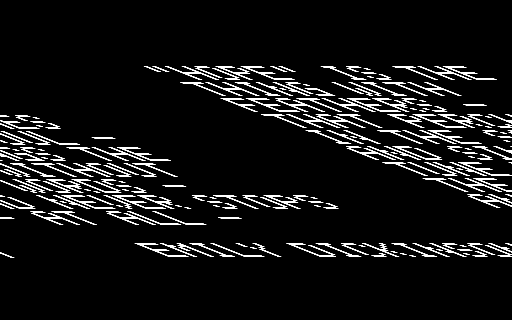
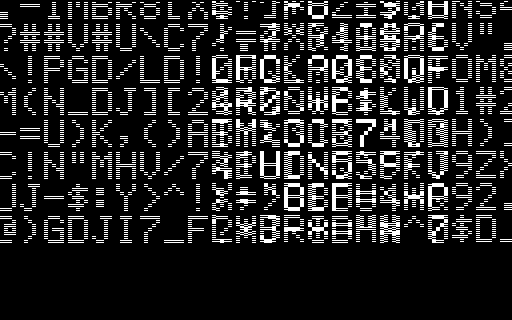

# P8k — Wrong Clock

Roadmap step P8k (ARCHITECTURE.md#roadmap): a new kind of Fault, a crystal oscillator can that runs at another frequency than the one printed on it, and seven hand-placed Puzzles that use it: three early Machines whose can runs three times too fast, four TV Machines whose can runs slow. Design: [WRONG_CLOCK_DESIGN.md](WRONG_CLOCK_DESIGN.md). Plan: [WRONG_CLOCK_PLAN.md](WRONG_CLOCK_PLAN.md).

## Why

Every Machine is clocked by one `OSC` can, ideal and always right. A Fault that leaves every chip working but at the wrong pace is new: no other Fault kind gives it. On the early Machines the User Manual states the pace (the Counter's LED "blinks about once a second", the Knob Meter reads 00 to 99 across the turn), so a can three times too fast shows. On a TV Machine every count down the chain divides that one clock, so a slow can takes the line and frame rates out of the TV's hold range: the picture tears, but stays structured (slanted text, giant letters), which none of today's Puzzles shows. The player measures X1 with the scope (its band reads the frequency, P8h) against the Service Manual's Components line, and swaps the can.

What the TV Machines look like with a slow can (`bw run --tv`, 2026-11-28; the frames the user approved):

| Message, 1.9 MHz | Typewriter, 2 MHz | BW-2001, 7.6 MHz | BW-80, 3.25 MHz |
|---|---|---|---|
|  |  |  |  |

## User decisions

The user, 2026-11-28:

- **Kept out of the random draw** (P8d). A Wrong Clock differs from the Golden Machine on every Machine, so Vetting would keep one even where the player cannot see it (the Dice). Hand-placed Puzzles only: "not the very best, but it'll do".
- **Speed decides the direction.** A faster can makes the simulation slower in proportion: none on the TV or computer Machines (the BW-2001 and BW-80 already run below real time). A slower can is cheaper to simulate, and the tearing it gives on a TV is welcome ("100 % fine for new tearing created by slowing down the crystal").
- **3× on three early Machines:** the Counter, the Stopwatch, the Knob Meter. Not the LED Chaser; not the LED Computer (6.3× real time natively, so 2.1× at 3 MHz and below real time in the web build); not the Dice (nothing shows).
- **Slow cans on four TV Machines:** the Message Display at 1.9 MHz (slanted text), the TV Typewriter at 2 MHz (giant letters), the BW-2001 at 7.6 MHz (slanted streaks of the boot text at the top; at half speed it is black), the BW-80 at 3.25 MHz (the K cursor alone on white).
- **The can keeps its design marking** (`1.000MHz` on the Board): the can is bad, not a wrong part fitted, so the player must measure it. Any frequency may be written.

Chosen without asking:

- **The line:** `fault clock X1 3MHz`, the frequency as `freq=` takes it (`ParseFrequencyPeriod`). Repaired by swapping the can, as a Switch Fault is.
- **The name:** Wrong Clock (GLOSSARY).
- **No rule in the code about faster cans.** The loader takes any frequency but the can's own; the recipe says faster only where the Machine keeps at least 2.5× real time natively at the new rate (so above real time in the web build, 0.4× native). The Stopwatch at 3 MHz runs 3.7×, the Counter 4.2×, the Knob Meter 6.2× (the review's measures, M5).
- **Each new Puzzle is appended to its Machine's ladder** (no file renamed, so saved ticks, keyed by path since P8e, stay). A clock is the innermost stage, measured last.
- **The Service Manuals stay as they are**: each Components list already gives X1's frequency, and the scope's band reads it.

## What the player sees

Titles and briefs are drafts, checked against each Puzzle's bench and Launcher post-it when it is made (ADD_PUZZLE.md: the brief says what the owner sees, never the cause).

1. **Counter, `04-quick-blink.bwp`** (`fault clock X1 3MHz`): the LED blinks about three times a second where the User Manual says once. Next to "LED too fast" (`U1.RCO` stuck high: about 15 times a second), the factor is the clue: every counter counts right, so the fault is before them.
   Title "Quick blink"; brief "The LED blinks steadily, but about three times a second."
2. **Stopwatch, `09-fast-seconds.bwp`** (`fault clock X1 3MHz`): START runs the display three times too fast: it reads about 3.00 after one second and rolls over from 9.99 every 3.3 s. A prescaler fault also gives a wrong rate; here `U1`'s output is a tenth of its input, as the manual says, and the input is 3 MHz.
   Title "Fast seconds"; brief "Press START: the seconds run far too fast. After one second the display already reads about 3.00."
3. **Knob Meter, `08-three-laps.bwp`** (`fault clock X1 3MHz`): the reading climbs from 00 to 99 three times across the turn (measured on seeds 1–3: 10 % reads 30, 25 % reads 75, 40 % reads 19, 90 % reads 68). The paddle's pulse comes from its own timer, off the Board, so the count of ticks in it triples.
   Title "Three laps"; brief "Turn the knob slowly to the right: the reading runs up to 99, falls back to 00 and climbs again, three times over."
4. **Message Display, `07-slanted-page.bwp`** (`fault clock X1 1.9MHz`): the page slides across the screen in slanting streaks; parts of words stay readable.
   Title "Slanted page"; brief "The TV cannot hold the page: the words slide across the screen in slanting streaks."
5. **TV Typewriter, `07-giant-letters.bwp`** (`fault clock X1 2MHz`): the letters twice their size, spilling off the screen; the TV cannot hold the page.
   Title "Giant letters"; brief "The letters on the TV are twice their size and spill off its edges, and the picture will not hold still."
6. **BW-2001, `17-slanted-banner.bwp`** (`fault clock X1 7.6MHz`): the monitor is dark but for slanting streaks of text near the top.
   Title "Slanted banner"; brief "The monitor stays dark but for a few slanting streaks of text near the top."
7. **BW-80, `16-stray-cursor.bwp`** (`fault clock X1 3.25MHz`): on the bench, a white screen with a dark band along the bottom and the K cursor alone in its middle (`bw run --tv` also gives a plain white frame with a bar at the top left; the bench shows the first).
   Title "Stray cursor"; brief "The screen is white with a dark band along the bottom, and the K cursor sits alone in the middle of it."

Every one is repaired by swapping `X1`; a wrong swap (the first suspect in the Service Manual's Troubleshooting) leaves it not completed. The can on the Board reads its design frequency throughout.

## What is new

1. **The Fault kind.** A `ClockDecl` line in a Puzzle; its checked form `WrongClock` in the Machine's Faults and the build's; the Oscillator taking another period after it is placed. A swap of the can removes it; `completed()` wants it gone. Not a `FaultKind`: never drawn at random.
2. **Seven Puzzles** (§1–§7), each with its test case and its lines in the Machine's docs.
3. **Docs:** ADD_PUZZLE (the line, the speed rule, the random draw, the steps a new kind needs), GLOSSARY (Wrong Clock), the README's counts (118 → 125 and each Machine's) and its list of fault kinds, the ARCHITECTURE row.

Untouched: the kernel, the TV, the instruments, the UI (no screen lists Fault kinds; the Give up page, which prints a Fault's line, is a Random fault's only), the Vetting and the random draw, the Boards and netlists, the manuals.

## Tests

- Unit: `puzzle: clock` (parse, errors), `puzzle: FormatFault of each kind` (the clock line), `puzzle: errors` (the catch-all text names `clock`), `puzzle: every Puzzle's faults format back` (the seven files, its count 121 → 128); `machine: clock fault errors` (a frequency the parser never saw too), `machine: a swap removes a Wrong Clock`, `machine: completed needs every Component and Joint Fault gone` (with a clock); `builder: a Wrong Clock reaches the oscillator` (the new period on `OUT`, the marking unchanged); `oscillator: setPeriod`; `machine list: the repository` (Counter 4, BW-2001 17, the new Counter title).
- Machine cases, one a Puzzle (`<machine>: <name>`): the symptom, X1's period, not completed after the tempting wrong swap, completed and the fault-free behaviour back after `swap X1`. TV cases: the TV not locked; the BW-2001 on seeds 1–3 as `no_clock`, the BW-80 on seed 1 (its frames are the same on every seed, and each seed costs seconds); both skipped in debug as their file's cases are.
- Speed (release, `bw run --time 2s`, the ratio): each new Puzzle, in the plan's notes. Expected from 2026-11-28's measures: Counter 4.2×, Stopwatch 3.7×, Knob Meter 6.2×, Message 2.7–3.0×, Typewriter 2.5–2.7×, BW-2001 0.40–0.44×, BW-80 0.53×.
- Screenshots (release, viewed): each Puzzle's bench (`bw_ui … --screenshot`); the Counter's with the scope on `X1.OUT` reading 3 MHz; the Launcher on a new post-it.
- Sanitizers (debug): the unit cases only (design, Checks).
- The full release suite (shared code changed).
- Only the user: playing two of them (one early, one TV) for fairness.

## Later

- A Wrong Clock in the random draw on the Machines where it shows, with a frequency drawn from a short list: needs Vetting to tell a visible wrong pace from an invisible one.
- A can marked with its real frequency (a wrong part fitted), for an easier Puzzle.
- Clocks other than the `OSC` can (an RC oscillator drifting with heat): with the Freezer's Flaky machines.
